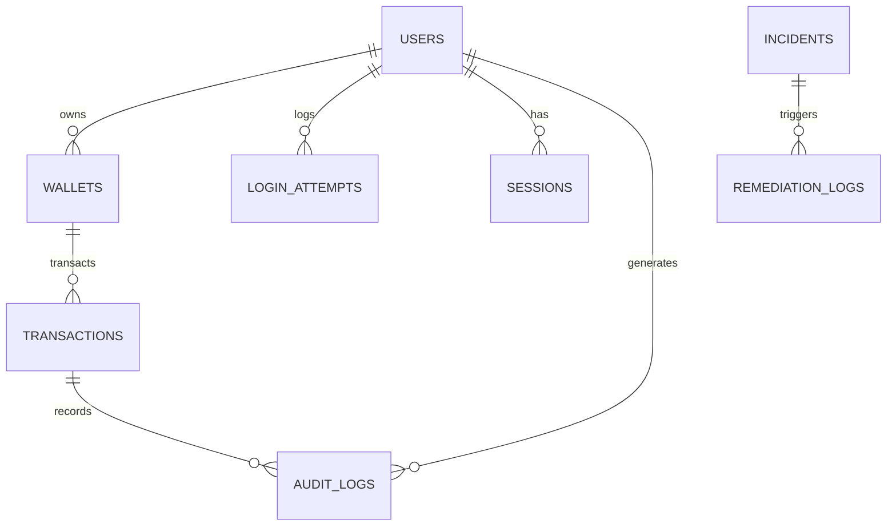

# 🗄️ Database Service — EPSI Pay (PostgreSQL 15)

This directory is the data foundation of the **EPSI Pay** platform for the **RESILIENCE-ALPHA** project.
It holds the Prisma schema, the seed/migration scripts and the project's **official data dictionary**.

---

## 📐 Entity-Relationship Diagram (ERD)



---

## 📋 Design Conventions & Standards

* **Engine & Version**: PostgreSQL 15 (strict ACID compliance for financial transactions).
* **Identifiers (Primary keys)**: UUID v4 (`String` in UUID format) to guarantee global uniqueness without collisions and to prevent sequential enumeration.
* **Monetary precision**: `Decimal(12, 2)` type (avoids IEEE 754 floating-point rounding errors).
* **Timestamps**: All `createdAt` and `updatedAt` fields are stored in UTC with time zone (`TIMESTAMPTZ`).
* **Concurrency & Resilience**: Optimistic locking (`version` on `wallets`) and idempotency keys (`idempotencyKey` on `transactions`).

---

## 📖 Official Data Dictionary

---

### MODULE 1: Authentication & Security (Brute Force Attack Target)

#### 1. Table `users`

> **Purpose:** Stores user accounts, their access privileges and the security state of their account during attacks.

| Field | SQL Type | Constraints | Business description | Security & Compliance | RESILIENCE-ALPHA role |
| :--- | :--- | :--- | :--- | :--- | :--- |
| `id` | `UUID` | **PK**, Not Null | Unique user identifier. | Not sensitive | Internal reference key. |
| `email` | `VARCHAR(255)` | **Unique**, Not Null | Email address used as the login identifier. | Personal data (GDPR) | Target of credential stuffing / brute force attacks. |
| `passwordHash` | `VARCHAR(255)` | Not Null | Hashed password (bcrypt/argon2). | Sensitive secret | Never transmitted in plain text. |
| `name` | `VARCHAR(255)` | Nullable | Full name or company name. | Personal data | Dashboard display. |
| `role` | `ENUM` | `CLIENT`, `MERCHANT`, `ADMIN` (default: `CLIENT`) | Application role and authorization level. | RBAC access control | Separates merchants from clients. |
| `status` | `ENUM` | `ACTIVE`, `LOCKED`, `SUSPENDED` | Current state of the user account. | DORA / NIS2 (integrity) | Switches to `LOCKED` when an intrusion is suspected. |
| `failedLoginAttempts` | `INTEGER` | Default: `0` | Counter of consecutive failed login attempts. | Security / Brute force | Incremented by the `auth` service during the attack. |
| `lockedUntil` | `TIMESTAMPTZ` | Nullable | Date/time until which the account is temporarily frozen. | Resilience | Enables autonomous unlocking after the incident. |
| `createdAt` | `TIMESTAMPTZ` | Default: `now()` | Account creation date. | Traceability | Account age audit. |
| `updatedAt` | `TIMESTAMPTZ` | Auto-update | Date of the account's last change. | Traceability | Detection of suspicious changes. |

---

#### 2. Table `login_attempts`

> **Purpose:** Logs every login attempt. **This is the main data source feeding the Machine Learning model.**

| Field | SQL Type | Constraints | Business description | Security & Compliance | RESILIENCE-ALPHA role |
| :--- | :--- | :--- | :--- | :--- | :--- |
| `id` | `UUID` | **PK**, Not Null | Attempt identifier. | Not sensitive | Indexing. |
| `attemptedEmail` | `VARCHAR(255)` | Not Null, Index | Raw email address entered in the form during the attempt. | Cyber traceability | Analysis of dictionary / credential stuffing attack patterns. |
| `targetUserId` | `UUID` | **FK** `users.id`, Nullable | Targeted user account if it exists in the database (`NULL` if the email is unknown or made up). | Traceability | Shows which exact account the attacker targeted. |
| `ipAddress` | `VARCHAR(45)` | Not Null, Index | IPv4 or IPv6 address of the remote client. | Sensitive data / Logs | **Detects the Attacker PC** for IP blocking. |
| `userAgent` | `TEXT` | Nullable | HTTP signature of the browser or attack tool (e.g. Hydra, Curl). | Cyber audit | Used as a discriminating feature by the ML model. |
| `isAuthenticated` | `BOOLEAN` | Not Null | `true` if the credentials were validated successfully, `false` otherwise. | Security | Explicit authentication success flag. |
| `failureReason` | `VARCHAR(100)` | Nullable | Reason (`INVALID_CREDENTIALS`, `ACCOUNT_LOCKED`, `IP_BLOCKED`). | Audit | Attack behavior analysis. |
| `createdAt` | `TIMESTAMPTZ` | Default: `now()`, Index | Precise timestamp of the attempt. | Monitoring | Velocity calculation (requests/second). |

---

#### 3. Table `blocked_ips`

> **Purpose:** Dynamic blacklist of malicious IP addresses. **Fed directly by the autonomous remediation engine.**

| Field | SQL Type | Constraints | Business description | Security & Compliance | RESILIENCE-ALPHA role |
| :--- | :--- | :--- | :--- | :--- | :--- |
| `id` | `UUID` | **PK**, Not Null | Blocking rule identifier. | Not sensitive | Indexing. |
| `ipAddress` | `VARCHAR(45)` | **Unique**, Index | IP address banned from the system. | Perimeter security | **Immediately stops the Attacker PC.** |
| `reason` | `VARCHAR(255)` | Not Null | Reason for the ban (`ML_ANOMALY_BRUTE_FORCE`, etc.). | Traceability | Justification of the action for the jury. |
| `blockedBy` | `VARCHAR(100)` | Default: `AUTO_REMEDIATION` | Entity that ordered the block (`AUTO_REMEDIATION`, `WAF`, `ADMIN`). | Governance / Audit | Proves the remediation is autonomous. |
| `isActive` | `BOOLEAN` | Default: `true`, Index | Whether the block is active. | Resilience | Allows the block to be lifted temporarily or permanently. |
| `blockedAt` | `TIMESTAMPTZ` | Default: `now()` | Date and time of the ban. | Metric | Used to compute the MTTR (response time). |
| `expiresAt` | `TIMESTAMPTZ` | Nullable | Expiry date of a temporary ban. | Resilience | Avoids permanently blocking dynamic addresses. |

---

#### 4. Table `sessions`

> **Purpose:** Keeps and revokes active login sessions.

| Field | SQL Type | Constraints | Business description | Security & Compliance | RESILIENCE-ALPHA role |
| :--- | :--- | :--- | :--- | :--- | :--- |
| `id` | `UUID` | **PK**, Not Null | Session identifier. | Not sensitive | Primary key. |
| `userId` | `UUID` | **FK** `users.id`, Cascade | Owner of the session. | Access control | Cascading revocation if the account is blocked. |
| `tokenHash` | `VARCHAR(255)` | **Unique**, Index | Hash of the session token. | Sensitive secret | Protection against session theft. |
| `ipAddress` | `VARCHAR(45)` | Nullable | IP address the session was opened from. | Security | Session theft detection (IP change). |
| `userAgent` | `TEXT` | Nullable | User-Agent at login. | Security | Environment fingerprint. |
| `isValid` | `BOOLEAN` | Default: `true` | Token validity status. | Security | Immediate revocation after an incident. |
| `expiresAt` | `TIMESTAMPTZ` | Not Null | End of the session's validity. | Security | Automatic access expiry. |
| `createdAt` | `TIMESTAMPTZ` | Default: `now()` | Login date. | Audit | Session history. |

---

### MODULE 2: Accounts & Wallets

#### 5. Table `wallets`

> **Purpose:** Payment accounts holding the funds of clients and merchants.

| Field | SQL Type | Constraints | Business description | Security & Compliance | RESILIENCE-ALPHA role |
| :--- | :--- | :--- | :--- | :--- | :--- |
| `id` | `UUID` | **PK**, Not Null | Unique wallet identifier. | Not sensitive | Financial routing reference. |
| `userId` | `UUID` | **FK** `users.id`, Restrict, Index | User who owns the wallet. | Strict isolation | A user can own dedicated wallets. |
| `currency` | `VARCHAR(3)` | Default: `EUR` | ISO 4217 currency code (EUR, USD). | Banking standard | Monetary consistency. |
| `balance` | `DECIMAL(12,2)` | Default: `0.00` | Actual available balance of the account. | Critical data | Debited/credited by payments. |
| `status` | `ENUM` | `ACTIVE`, `FROZEN`, `CLOSED` | Operational state of the wallet. | DORA / Risk | A suspicious wallet can be frozen. |
| `version` | `INTEGER` | Default: `0` | Incremental version number. | Financial integrity | **Optimistic Concurrency Lock:** prevents concurrent double debits. |
| `createdAt` | `TIMESTAMPTZ` | Default: `now()` | Wallet opening date. | Traceability | Accounting history. |
| `updatedAt` | `TIMESTAMPTZ` | Auto-update | Date of the last balance movement. | Audit | Traceability of entries. |

---

### MODULE 3: Payments & Transactions

#### 6. Table `transactions`

> **Purpose:** Immutable history of every financial movement and recovery test transaction.

| Field | SQL Type | Constraints | Business description | Security & Compliance | RESILIENCE-ALPHA role |
| :--- | :--- | :--- | :--- | :--- | :--- |
| `id` | `UUID` | **PK**, Not Null | Internal transaction identifier. | Not sensitive | Primary key. |
| `reference` | `VARCHAR(100)` | **Unique**, Not Null | Public transaction reference (e.g. `TX-20261019-XXXX`). | Bank reconciliation | Reference given to the client and merchant. |
| `idempotencyKey` | `VARCHAR(255)` | **Unique**, Nullable | Key sent by the HTTP client to avoid duplicates. | **Network resilience** | Allows automatic retries without double debits. |
| `type` | `ENUM` | `PAYMENT`, `TRANSFER`, `REFUND`, `VALIDATION_TEST` | Nature of the financial operation. | Business | **`VALIDATION_TEST` proves "it works again" after remediation.** |
| `status` | `ENUM` | `PENDING`, `SUCCESS`, `FAILED`, `BLOCKED` | Lifecycle status of the transaction. | State machine | Shown in real time on the Dashboard. |
| `amount` | `DECIMAL(12,2)` | Not Null | Total amount of the transaction. | Financial data | Prior funds check. |
| `currency` | `VARCHAR(3)` | Default: `EUR` | Currency. | Standard | ISO format compliance. |
| `description` | `VARCHAR(255)` | Nullable | Label or purpose of the transaction. | Client information | Readable statements. |
| `senderWalletId` | `UUID` | **FK** `wallets.id`, Nullable | Sender's wallet (debit). | Traceability | Nullable for external funding. |
| `receiverWalletId` | `UUID` | **FK** `wallets.id`, Not Null | Receiver's wallet (credit). | Traceability | Credited wallet. |
| `clientIp` | `VARCHAR(45)` | Nullable | Originating IP address of the payment. | Anti-fraud | Data for the ML model. |
| `userAgent` | `TEXT` | Nullable | HTTP client fingerprint. | Anti-fraud | Detection of scripted bots. |
| `fraudScore` | `FLOAT` | Nullable (0.0 to 1.0) | Fraud probability score computed by the ML. | **AI / ML** | If `score > 0.85` $\rightarrow$ transaction blocked. |
| `fraudReason` | `VARCHAR(255)` | Nullable | Rule or anomaly reason raised by the AI. | AI explainability | Decision transparency. |
| `metadata` | `JSONB` | Nullable | Free-form context data (cart, headers). | Extensibility | Extra context without changing the schema. |
| `createdAt` | `TIMESTAMPTZ` | Default: `now()` | Date and time it was triggered. | Legal timestamp | Execution order. |
| `updatedAt` | `TIMESTAMPTZ` | Auto-update | Date of the last status update. | Traceability | Processing time. |

---

### MODULE 4: Resilience & Autonomous Remediation

#### 7. Table `incidents`

> **Purpose:** Records every failure or attack detected by the ML or the monitoring.

| Field | SQL Type | Constraints | Business description | Security & Compliance | RESILIENCE-ALPHA role |
| :--- | :--- | :--- | :--- | :--- | :--- |
| `id` | `UUID` | **PK**, Not Null | Unique incident identifier. | Not sensitive | Indexing. |
| `incidentType` | `ENUM` | `BRUTE_FORCE_AUTH`, `AUTH_SERVICE_DOWN`, etc. | Classification of the threat or failure. | EBIOS RM / NIS2 | Categorizes the Red Team attack. |
| `severity` | `ENUM` | `LOW`, `MEDIUM`, `HIGH`, `CRITICAL` | Level of impact on IS availability. | DORA (criticality) | Triggers remediation escalation. |
| `status` | `ENUM` | `DETECTED`, `REMEDIATING`, `RESOLVED`, `FAILED` | Progress of the automatic resolution. | Monitoring | Dashboard color code (Orange $\rightarrow$ Green). |
| `detectedBy` | `VARCHAR(100)` | Default: `MACHINE_LEARNING` | Detection source (`MACHINE_LEARNING`, `PROMETHEUS`). | **AI / DATA** | Demonstrates intelligent detection (no fixed threshold). |
| `targetService` | `VARCHAR(100)` | Default: `Auth` | Component targeted by the failure or attack. | Architecture | Identifies the service to heal. |
| `targetIp` | `VARCHAR(45)` | Nullable | Source IP identified as aggressive. | Cyber | IP passed to the blocker. |
| `metricsSnapshot` | `JSONB` | Nullable | Snapshot of the metrics at time T (RPM, errorRate). | Observability | Justification of the alert for the jury. |
| `detectedAt` | `TIMESTAMPTZ` | Default: `now()` | Time T of detection. | MTTR | Starts the remediation timer. |
| `resolvedAt` | `TIMESTAMPTZ` | Nullable | Time T when the return to normal was confirmed. | MTTR | Stops the remediation timer. |

---

#### 8. Table `remediation_logs`

> **Purpose:** Logs every autonomous corrective action and how long it took to succeed (proof of remediation).

| Field | SQL Type | Constraints | Business description | Security & Compliance | RESILIENCE-ALPHA role |
| :--- | :--- | :--- | :--- | :--- | :--- |
| `id` | `UUID` | **PK**, Not Null | Action log identifier. | Not sensitive | Primary key. |
| `incidentId` | `UUID` | **FK** `incidents.id`, Cascade | Reference to the incident being handled. | Traceability | Groups actions by incident. |
| `actionTaken` | `ENUM` | `IP_BLOCK_ENFORCED`, `AUTH_SERVICE_RESTARTED`, `TEST_PAYMENT_VERIFIED` | Corrective action applied. | **Auto Remediation** | Demonstrates the autonomous repair loop. |
| `executedBy` | `VARCHAR(100)` | Default: `AUTO_REMEDIATION_ENGINE` | Name of the remediation bot / engine. | DORA / NIS2 | Proves no human intervention was needed (0/5 avoided). |
| `isSuccess` | `BOOLEAN` | Default: `true` | Success or failure of the recovery measure. | Resilience | Gates the next step. |
| `durationMs` | `INTEGER` | Nullable | Execution time of the action in milliseconds. | Performance | **Measured proof for the 60s Timed Clip.** |
| `details` | `JSONB` | Nullable | Technical payload of the action (commands, outputs). | Technical audit | Logs the team can use. |
| `createdAt` | `TIMESTAMPTZ` | Default: `now()` | Date and time of the action. | Traceability | Time sequencing. |

---

### MODULE 5: Audit & Regulatory Compliance

#### 9. Table `audit_logs`

> **Purpose:** Immutable (*append-only*) log of all sensitive operations, for NIS2 / DORA compliance and to feed the SIEM (Wazuh).

| Field | SQL Type | Constraints | Business description | Security & Compliance | RESILIENCE-ALPHA role |
| :--- | :--- | :--- | :--- | :--- | :--- |
| `id` | `UUID` | **PK**, Not Null | Audit record identifier. | Not modifiable | Primary key. |
| `userId` | `UUID` | **FK** `users.id`, Nullable | User who caused the action (if authenticated). | Accountability (NIS2) | Know who did what. |
| `transactionId` | `UUID` | **FK** `transactions.id`, Nullable | Related financial transaction (if any). | Financial integrity | Traceability of money movements. |
| `action` | `VARCHAR(100)` | Not Null, Index | Event code (e.g. `BRUTE_FORCE_DETECTED`, `IP_BANNED`). | SIEM standard | Ingested by Wazuh / Grafana Loki. |
| `severity` | `ENUM` | `INFO`, `WARNING`, `CRITICAL` | Severity of the audited event. | Security alert | Filtering of critical incidents. |
| `details` | `JSONB` | Nullable | Full audit data (payload, headers). | Forensics | Post-mortem analysis during the Red Team exercise. |
| `ipAddress` | `VARCHAR(45)` | Nullable | Originating IP of the event. | Network traceability | Forensic evidence. |
| `createdAt` | `TIMESTAMPTZ` | Default: `now()`, Index | Official, unalterable timestamp. | Legal proof | Immutability of the audit trail. |

---

## 🐳 Seeder (`database` container)

The `database` container is a one-off job. On startup, it:

1. applies the schema (`prisma db push`);
2. runs the seed selected by `SEED_SCRIPT`;
3. **exits** (code 0). `auth` and `payment` wait for it to finish (`service_completed_successfully`).

| Variable | Default | Purpose |
| :--- | :--- | :--- |
| `DB_HOST`, `DB_PORT`, `DB_NAME`, `DB_USER`, `DB_PASSWORD` | `DB_PORT`: `5432` | PostgreSQL connection. |
| `SEED_SCRIPT` | `seed-10k` | `seed-10k`: 10,000+ records, skipped if the database is already populated. `seed`: minimal dataset, **empties the tables** before inserting. |
| `SEED_USER_PASSWORD` | *(built-in dev default)* | Password (bcrypt-hashed) of every seeded account. Set your own, e.g. `FakeSeedPassw0rd-Example`. |

Example with fake values:

```bash
DB_HOST=localhost DB_PORT=5432 DB_NAME=fake_db DB_USER=fake_user DB_PASSWORD=fake-db-password-0000 \
SEED_USER_PASSWORD=FakeSeedPassw0rd-Example npm --prefix database start
```

Both seeds create the `system-bot@epsi-pay.internal` account and its wallet, used by `POST /payments/test-validation`.

---

## 🛠️ Database Commands

From the project root:

```bash
# Start the PostgreSQL 15 container
npm run db:up

# Run the seeder (schema + 10k records, then exit)
npm run db:seed

# Apply the Prisma schema manually
npm run prisma:push

# Open the Prisma Studio graphical explorer
npm run prisma:studio
```

From `database/`, without Docker (after `npm install`):

```bash
npm run seed       # Minimal dataset
npm run seed:10k   # Large dataset
```
